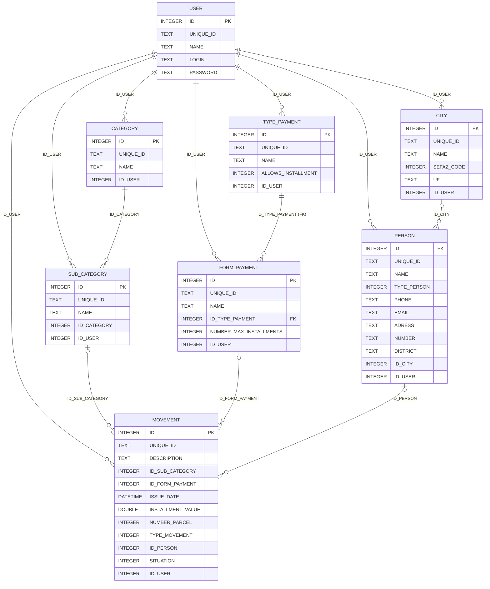

# Banco de dados: Personal Financial Control

Documentação da estrutura do banco SQLite usado pela versão Delphi do sistema. Serve de referência para manutenção e para a migração para a versão nova em JavaScript (aplicação desktop com Electron e aplicação web, que compartilham regras e interface).

> Este documento **descreve o estado atual** do banco. As observações em [Pontos de atenção](#8-pontos-de-atenção) são apenas registro e não foram aplicadas.
> Os números e o diagnóstico dos dados são de **05/10/2026**.

## Sumário

1. [Visão geral](#1-visão-geral)
2. [Diagrama de relacionamentos](#2-diagrama-de-relacionamentos)
3. [Convenções](#3-convenções)
4. [Valores codificados (domínios)](#4-valores-codificados-domínios)
5. [Tabelas](#5-tabelas)
6. [Relacionamentos](#6-relacionamentos)
7. [Criação, carga inicial e limpeza](#7-criação-carga-inicial-e-limpeza)
8. [Pontos de atenção](#8-pontos-de-atenção)
9. [Diagnóstico dos dados atuais](#9-diagnóstico-dos-dados-atuais)
10. [Anexo: DDL atual](#10-anexo-ddl-atual)

---

## 1. Visão geral

| Item | Valor |
|---|---|
| Motor | SQLite 3 |
| Arquivo | `database/PersonalFinancialControl` (sem extensão) |
| Localização em execução | pasta `database\` ao lado do executável (`TFunctions.DataBasePath`) |
| Acesso | FireDAC, conexão única compartilhada (`TDataBaseConnection`, singleton) |
| Codificação | UTF-8 |
| Journal mode | `delete` (gera o arquivo `PersonalFinancialControl-journal` durante transações) |
| `PRAGMA foreign_keys` | **desligado** (0): a única FK declarada não é verificada |
| `PRAGMA user_version` | 0 (não há controle de versão do esquema) |
| Tabelas | 8 tabelas de dados + `sqlite_sequence` (interna do SQLite) |

**Volume atual**

| Tabela | Registros | Último ID gerado |
|---|---:|---:|
| `MOVEMENT` | 82 | 377 |
| `SUB_CATEGORY` | 32 | 57 |
| `PERSON` | 27 | 37 |
| `CATEGORY` | 11 | 37 |
| `FORM_PAYMENT` | 10 | 22 |
| `TYPE_PAYMENT` | 7 | 18 |
| `CITY` | 3 | 3 |
| `USER` | 1 | 8 |

A diferença entre o número de registros e o último ID gerado vem de exclusões e das limpezas feitas pela tela de Utilitários.

---

## 2. Diagrama de relacionamentos

As linhas representam as ligações **lógicas** usadas pelo código. Só `FORM_PAYMENT → TYPE_PAYMENT` existe como chave estrangeira declarada no banco (ver [seção 6](#6-relacionamentos)).



**Leitura rápida**

- **Classificação:** `CATEGORY` (1) → (N) `SUB_CATEGORY` (1) → (N) `MOVEMENT`
- **Pagamento:** `TYPE_PAYMENT` (1) → (N) `FORM_PAYMENT` (1) → (N) `MOVEMENT`
- **Pessoas:** `CITY` (1) → (N) `PERSON` (1) → (N) `MOVEMENT`
- **Dono do registro:** todas as tabelas, exceto `USER`, guardam o `ID_USER` de quem criou.

---

## 3. Convenções

### Identificadores

Toda tabela tem dois identificadores:

| Campo | Tipo | Uso no código |
|---|---|---|
| `ID` | `INTEGER PRIMARY KEY AUTOINCREMENT` | Chave usada nas **ligações** entre tabelas e nas leituras (`GetById`) |
| `UNIQUE_ID` | Texto, UUID v4 em maiúsculas sem chaves (ex.: `7F47C24D-490D-41B0-B157-F4C469A7ED58`, 36 caracteres) | Chave usada nos **UPDATE** e **DELETE** (`WHERE UNIQUE_ID = :UNIQUE_ID`) |

O `UNIQUE_ID` é gerado pela aplicação (`TFunctions.GenerateUUID`) no momento da inclusão. **Não há índice nem restrição `UNIQUE`** sobre ele.

### Nomes

- Tabelas e campos em inglês, maiúsculas, com `_` (`SUB_CATEGORY`, `ID_FORM_PAYMENT`).
- Chave estrangeira lógica: prefixo `ID_` + nome da tabela referenciada (`ID_CATEGORY`, `ID_CITY`…).
- Grafia herdada: `PERSON.ADRESS` (com um "d" só).
- `USER` e `NUMBER` são palavras sensíveis em SQL; no DDL aparecem entre aspas (`"USER"`, `"NUMBER"`), mas o código as usa sem aspas e o SQLite aceita.

### Tipos

O SQLite usa **afinidade de tipo**: o tamanho declarado (`TEXT(300)`, `VARCHAR(2)`) **não é aplicado**, e qualquer coluna pode receber qualquer tipo. Na prática:

| Declarado | Como os dados estão gravados |
|---|---|
| `TEXT(n)` / `VARCHAR(n)` | texto UTF-8; o limite `n` é só informativo |
| `INTEGER` | inteiro. Exceção: `PERSON.ID_CITY` tem registros com texto vazio `''` (ver [seção 9](#9-diagnóstico-dos-dados-atuais)) |
| `DATETIME` | **texto** no formato `YYYY-MM-DD`, sem hora (`'2023-08-16'`). As consultas usam `strftime('%m'/'%Y', ISSUE_DATE)` |
| `DOUBLE` | ponto flutuante (`real`); todos os valores atuais têm no máximo 2 casas decimais |
| Booleano | `INTEGER` 0/1 (não existe tipo booleano no SQLite) |

### Exclusões

Todas as exclusões são **físicas** (`DELETE`), sem exclusão lógica, sem histórico e **sem verificar se há registros dependentes**.

---

## 4. Valores codificados (domínios)

Os campos abaixo guardam números que correspondem a enumerações do código (`class/uEnumTypes.pas`). A ordem do enum define o valor gravado.

| Tabela.Campo | Valor | Significado | Enum Delphi |
|---|---:|---|---|
| `MOVEMENT.TYPE_MOVEMENT` | 0 | Receita (entrada) | `tmRevenues` |
| | 1 | Despesa (saída) | `tmExpenses` |
| `MOVEMENT.SITUATION` | 0 | Não pago | — |
| | 1 | Pago | — |
| `PERSON.TYPE_PERSON` | 0 | Fornecedor | `tpProvider` |
| | 1 | Cliente | `tpCustomer` |
| `TYPE_PAYMENT.ALLOWS_INSTALLMENT` | 0 | Não permite parcelamento | `False` |
| | 1 | Permite parcelamento | `True` |

> Não existem restrições `CHECK` no banco; nada impede gravar outros valores nesses campos.

---

## 5. Tabelas

Legenda das colunas: **PK** = chave primária · **Obrig.** = `NOT NULL` · **Padrão** = valor `DEFAULT`.

### 5.1 `USER`: usuários

Usuários que podem acessar o sistema. É a única tabela sem `ID_USER`.

| Campo | Tipo | PK | Obrig. | Padrão | Descrição |
|---|---|:-:|:-:|---|---|
| `ID` | INTEGER | ✔ | | autoincremento | Identificador |
| `UNIQUE_ID` | TEXT(200) | | | | UUID |
| `NAME` | TEXT(300) | | | | Nome exibido na tela principal |
| `LOGIN` | TEXT(300) | | | | Login de acesso |
| `PASSWORD` | TEXT(300) | | | | Senha, **em texto puro** |

- Nenhum campo é `NOT NULL`, e não há `UNIQUE` em `LOGIN`.
- Login: `SELECT * FROM USER WHERE LOGIN = :LOGIN AND PASSWORD = :PASSWORD` (`TUser.ValidateLogin`).
- Telas: Login, Usuários (`forms/fUser`).

### 5.2 `CATEGORY`: categorias

Agrupamento de nível mais alto das movimentações (ex.: Alimentação, Casa e lar, Salário).

| Campo | Tipo | PK | Obrig. | Padrão | Descrição |
|---|---|:-:|:-:|---|---|
| `ID` | INTEGER | ✔ | ✔ | autoincremento | Identificador |
| `UNIQUE_ID` | TEXT(200) | | ✔ | | UUID |
| `NAME` | TEXT(300) | | ✔ | | Nome da categoria |
| `ID_USER` | INTEGER | | | | Usuário que criou → `USER.ID` |

- Índice: `CATEGORY_ID_IDX` (UNIQUE em `ID`), redundante porque `ID` já é a chave primária.
- Referenciada por: `SUB_CATEGORY.ID_CATEGORY`.
- Tela: Categorias (`forms/fCategory`).

### 5.3 `SUB_CATEGORY`: subcategorias

Detalhamento da categoria. **É a subcategoria que se liga à movimentação**; a categoria é obtida através dela.

| Campo | Tipo | PK | Obrig. | Padrão | Descrição |
|---|---|:-:|:-:|---|---|
| `ID` | INTEGER | ✔ | ✔ | autoincremento | Identificador |
| `UNIQUE_ID` | TEXT(200) | | ✔ | | UUID |
| `NAME` | TEXT(300) | | ✔ | | Nome da subcategoria |
| `ID_CATEGORY` | INTEGER | | ✔ | | Categoria-mãe → `CATEGORY.ID` |
| `ID_USER` | INTEGER | | | | Usuário que criou → `USER.ID` |

- Referenciada por: `MOVEMENT.ID_SUB_CATEGORY`.
- Tela: Sub-Categorias (`forms/fSubCategory`).

### 5.4 `TYPE_PAYMENT`: tipos de pagamento

Meio de pagamento genérico (Dinheiro, Pix, Cartão de Crédito…).

| Campo | Tipo | PK | Obrig. | Padrão | Descrição |
|---|---|:-:|:-:|---|---|
| `ID` | INTEGER | ✔ | ✔ | autoincremento | Identificador |
| `UNIQUE_ID` | TEXT(200) | | ✔ | | UUID |
| `NAME` | TEXT(300) | | ✔ | | Nome do tipo |
| `ALLOWS_INSTALLMENT` | INTEGER | | | `0` | Permite parcelamento (0/1) |
| `ID_USER` | INTEGER | | | | Usuário que criou → `USER.ID` |

- Referenciada por: `FORM_PAYMENT.ID_TYPE_PAYMENT`.
- `ALLOWS_INSTALLMENT` é cadastrado mas **não é consultado** na geração de parcelas.
- Tela: Tipos de Pagamento (`forms/fTypePayment`).

### 5.5 `FORM_PAYMENT`: formas de pagamento

Instância concreta de um tipo de pagamento, normalmente ligada a uma conta ou cartão (ex.: "Cartão de Crédito NuBank", "Pix SICREDI CPF").

| Campo | Tipo | PK | Obrig. | Padrão | Descrição |
|---|---|:-:|:-:|---|---|
| `ID` | INTEGER | ✔ | ✔ | autoincremento | Identificador |
| `UNIQUE_ID` | TEXT(200) | | ✔ | | UUID |
| `NAME` | TEXT(200) | | ✔ | | Nome da forma de pagamento |
| `ID_TYPE_PAYMENT` | INTEGER | | ✔ | | Tipo → `TYPE_PAYMENT.ID` (**FK declarada**: `FORM_PAYMENT_FK`) |
| `NUMBER_MAX_INSTALLMENTS` | INTEGER | | | `0` | Número máximo de parcelas |
| `ID_USER` | INTEGER | | | | Usuário que criou → `USER.ID` |

- Referenciada por: `MOVEMENT.ID_FORM_PAYMENT`.
- `NUMBER_MAX_INSTALLMENTS` é cadastrado mas **não é validado** na geração de parcelas.
- Tela: Formas de Pagamento (`forms/fFormPayment`).

### 5.6 `CITY`: cidades

| Campo | Tipo | PK | Obrig. | Padrão | Descrição |
|---|---|:-:|:-:|---|---|
| `ID` | INTEGER | ✔ | ✔ | autoincremento | Identificador |
| `UNIQUE_ID` | VARCHAR(200) | | ✔ | | UUID |
| `NAME` | VARCHAR(300) | | ✔ | | Nome da cidade |
| `SEFAZ_CODE` | INTEGER | | | | Código do município (IBGE, usado pela SEFAZ). Ex.: Tapes = 4321105 |
| `UF` | VARCHAR(2) | | | | Sigla do estado |
| `ID_USER` | INTEGER | | | | Usuário que criou → `USER.ID` |

- Índice: `CITY_ID_IDX` (UNIQUE em `ID`), redundante.
- Referenciada por: `PERSON.ID_CITY`.
- É a **única tabela criada pela própria aplicação** (ver [seção 7](#7-criação-carga-inicial-e-limpeza)).
- Tela: Cidades (`forms/fCity`).

### 5.7 `PERSON`: fornecedores e clientes

Uma única tabela para os dois papéis, diferenciados por `TYPE_PERSON`. No código, `TProvider` e `TCustomer` herdam de `TPerson`.

| Campo | Tipo | PK | Obrig. | Padrão | Descrição |
|---|---|:-:|:-:|---|---|
| `ID` | INTEGER | ✔ | ✔ | autoincremento | Identificador |
| `UNIQUE_ID` | TEXT(200) | | ✔ | | UUID |
| `NAME` | TEXT(300) | | ✔ | | Nome / razão social |
| `TYPE_PERSON` | INTEGER | | ✔ | | 0 = Fornecedor, 1 = Cliente |
| `PHONE` | TEXT(50) | | | | Telefone |
| `EMAIL` | TEXT(200) | | | | E-mail |
| `ADRESS` | TEXT(200) | | | | Endereço (logradouro) |
| `NUMBER` | TEXT(50) | | | | Número do endereço (texto: aceita "s/n", "123A") |
| `DISTRICT` | TEXT(200) | | | | Bairro |
| `ID_CITY` | INTEGER | | | | Cidade → `CITY.ID` |
| `ID_USER` | INTEGER | | | | Usuário que criou → `USER.ID` |

- Campos de texto não preenchidos são gravados como `''` (texto vazio), não como `NULL`.
- Referenciada por: `MOVEMENT.ID_PERSON`.
- A busca da tela faz `INNER JOIN CITY`, então **pessoas sem cidade válida não aparecem na listagem**.
- Telas: Fornecedores (`forms/fProvider`), Clientes (`forms/fCustomer`).

### 5.8 `MOVEMENT`: movimentações (receitas e despesas)

Tabela central do sistema. **Cada linha é uma parcela**: uma compra em 10 vezes gera 10 linhas.

| Campo | Tipo | PK | Obrig. | Padrão | Descrição |
|---|---|:-:|:-:|---|---|
| `ID` | INTEGER | ✔ | ✔ | autoincremento | Identificador |
| `UNIQUE_ID` | TEXT(200) | | ✔ | | UUID (um por parcela) |
| `DESCRIPTION` | TEXT(300) | | ✔ | | Descrição (repetida em todas as parcelas) |
| `ID_SUB_CATEGORY` | INTEGER | | | | Subcategoria → `SUB_CATEGORY.ID` |
| `ID_FORM_PAYMENT` | INTEGER | | | | Forma de pagamento → `FORM_PAYMENT.ID` |
| `ISSUE_DATE` | DATETIME | | | | **Data de vencimento** da parcela, texto `YYYY-MM-DD` |
| `INSTALLMENT_VALUE` | DOUBLE | | | `0` | Valor da parcela (R$) |
| `NUMBER_PARCEL` | INTEGER | | | `0` | Número da parcela (1, 2, 3…) |
| `TYPE_MOVEMENT` | INTEGER | | | `0` | 0 = Receita, 1 = Despesa |
| `ID_PERSON` | INTEGER | | | | Pessoa → `PERSON.ID` (fornecedor na despesa, cliente na receita) |
| `SITUATION` | INTEGER | | | `0` | 0 = Não pago, 1 = Pago |
| `ID_USER` | INTEGER | | | | Usuário que criou → `USER.ID` |

**Como as parcelas são gravadas** (`forms/fMovement`, `InstallmentsGenerate`)

- Para N parcelas são inseridas N linhas, com `NUMBER_PARCEL` de 1 a N.
- Todas têm a mesma `DESCRIPTION`, o mesmo `INSTALLMENT_VALUE` (o valor digitado já é o da parcela) e `SITUATION = 0`.
- `ISSUE_DATE` começa na data da primeira parcela e soma 1 mês a cada linha (`IncMonth`).
- **Não existe campo que agrupe as parcelas de uma mesma compra**, nem o total de parcelas ou o valor total. Só é possível reagrupar de forma aproximada (mesma descrição, subcategoria, forma de pagamento e valor).

**Operações**

| Operação | SQL resumido |
|---|---|
| Efetuar pagamento | `UPDATE MOVEMENT SET SITUATION = 1 WHERE UNIQUE_ID = :UNIQUE_ID` |
| Listagem (Gerenciar movimentações) | `MOVEMENT` com `LEFT JOIN` em `SUB_CATEGORY`, `FORM_PAYMENT` e `PERSON`; filtros por descrição (`LIKE`), situação e mês/ano de `ISSUE_DATE` |
| Gráficos | `SUM(INSTALLMENT_VALUE)` agrupado por `FORM_PAYMENT.NAME`, `SUB_CATEGORY.NAME` ou `CATEGORY.NAME` (via subcategoria), separado por `TYPE_MOVEMENT` |

- Telas: Cadastrar Receitas / Despesas (`forms/fMovement`), Gerenciar movimentações (`forms/fManageMovements`), Gráficos (`forms/fMovementGraphics`).

---

## 6. Relacionamentos

| Origem (campo) | Destino | Cardinalidade | Declarada no banco? | Ao excluir o destino |
|---|---|---|:-:|---|
| `SUB_CATEGORY.ID_CATEGORY` | `CATEGORY.ID` | N : 1 (obrigatória) | não | nada acontece; a subcategoria fica órfã |
| `FORM_PAYMENT.ID_TYPE_PAYMENT` | `TYPE_PAYMENT.ID` | N : 1 (obrigatória) | **sim** (`FORM_PAYMENT_FK`) | não é verificada, porque `foreign_keys` está desligado |
| `PERSON.ID_CITY` | `CITY.ID` | N : 1 (opcional) | não | pessoa fica com cidade inexistente |
| `MOVEMENT.ID_SUB_CATEGORY` | `SUB_CATEGORY.ID` | N : 1 (opcional) | não | movimento fica órfão |
| `MOVEMENT.ID_FORM_PAYMENT` | `FORM_PAYMENT.ID` | N : 1 (opcional) | não | movimento fica órfão |
| `MOVEMENT.ID_PERSON` | `PERSON.ID` | N : 1 (opcional) | não | movimento fica órfão |
| `<todas>.ID_USER` | `USER.ID` | N : 1 | não | registros ficam sem dono válido |

Observações:

- **"Vazio" é gravado como `0`.** Quando um campo de ligação não é preenchido na tela, o código grava `0` (não `NULL`). Como não existe registro com `ID = 0`, o efeito é o mesmo de uma ligação vazia, mas consultas com `IS NULL` não o encontram.
- **`ID_USER` não isola os dados.** O campo é gravado em toda inclusão, mas nenhuma consulta filtra por ele: todos os usuários veem e alteram todos os registros.
- **Não há índices nas colunas de ligação.** Com o volume atual isso não pesa, mas toda junção percorre a tabela inteira.

---

## 7. Criação, carga inicial e limpeza

### Criação e evolução do esquema

Na inicialização (`PersonalFinancialControl.dpr` → `TDataBaseScripts.ExecuteScripts`), a aplicação conecta ao banco e executa os scripts em `class/uDataBaseScripts.pas`:

| Verificação | Ação |
|---|---|
| Tabela `CITY` não existe | Cria `CITY` e o índice `CITY_ID_IDX` |

**As outras 7 tabelas não são criadas pelo código.** Foram criadas manualmente durante o desenvolvimento, e as colunas `ID_USER`, `ALLOWS_INSTALLMENT`, `NUMBER_MAX_INSTALLMENTS` e os campos finais de `MOVEMENT` foram adicionadas depois com `ALTER TABLE` (isso aparece no DDL, onde essas colunas vêm após o fechamento original). Ou seja, **a aplicação não consegue gerar um banco novo do zero**: depende do arquivo existente.

Existe também uma função `ColumnExists` preparada para futuras migrações, mas ela não é usada e o SQL dela tem um parêntese a mais.

### Carga inicial (Utilitários → apagar tudo)

A tela `forms/fUtilities` executa, nesta ordem:

1. **Limpeza (`EmptyAllTables`):** `DELETE` em `MOVEMENT`, `FORM_PAYMENT`, `PERSON`, `SUB_CATEGORY`, `USER`, `TYPE_PAYMENT`, `CATEGORY`. **`CITY` não é apagada.** Os contadores de `sqlite_sequence` não são zerados, então os novos IDs continuam a partir do último.
2. **Usuário padrão:** nome `Administrador`, login `admin`, senha `admin`.
3. **Tipos de pagamento:**

   | Nome | Permite parcelamento |
   |---|:-:|
   | Dinheiro | 0 |
   | Cartão de Crédito | 1 |
   | Cartão de Débito | 0 |
   | Pix | 0 |
   | Vale | 0 |

4. **Categorias:** `Salário`, `Diversos`.

> Na carga inicial, os registros dos passos 3 e 4 são gravados com o `ID_USER` do usuário logado no momento da limpeza, que acabou de ser apagado.

---

## 8. Pontos de atenção

Lista para orientar a migração. **Nenhum destes itens foi alterado.**

| # | Tema | Situação atual | Impacto |
|---|---|---|---|
| 1 | Integridade referencial | Só uma FK declarada, e `foreign_keys` está desligado | Exclusões deixam registros órfãos (ver seção 9) |
| 2 | Ligação vazia | Gravada como `0` em vez de `NULL` | Ligações inválidas difíceis de distinguir de "não informado" |
| 3 | Valores monetários | `DOUBLE` (ponto flutuante) | Risco de erro de arredondamento em somas; em JS, preferir centavos inteiros |
| 4 | Datas | Texto `YYYY-MM-DD` em coluna `DATETIME` | Funciona com `strftime` e ordena corretamente; manter o formato ISO |
| 5 | Parcelas | Sem identificador do grupo de parcelas | Não dá para editar, excluir ou pagar uma compra parcelada como um todo |
| 6 | Senhas | Texto puro em `USER.PASSWORD` | Qualquer acesso ao arquivo expõe as senhas |
| 7 | Multiusuário | `ID_USER` gravado mas nunca filtrado | Usuários compartilham todos os dados |
| 8 | Unicidade | Sem `UNIQUE` em `UNIQUE_ID` nem em `USER.LOGIN` | Possível duplicidade de login |
| 9 | Domínios | Sem `CHECK` nos campos codificados | Valores inválidos podem ser gravados |
| 10 | Versão do esquema | Sem `user_version` nem tabela de migrações; só `CITY` é criada por código | Não é possível recriar ou atualizar o banco de forma controlada |
| 11 | Índices | Índices redundantes em `CATEGORY.ID` e `CITY.ID`; nenhum nas colunas `ID_*` | Sem impacto hoje; relevante se o volume crescer |
| 12 | Regras não aplicadas | `ALLOWS_INSTALLMENT` e `NUMBER_MAX_INSTALLMENTS` não limitam o parcelamento | Campos cadastrados sem efeito |

---

## 9. Diagnóstico dos dados atuais

Levantamento feito em 05/10/2026 sobre uma cópia do banco.

**Distribuição**

| Item | Valores |
|---|---|
| Movimentos por tipo | 23 receitas · 59 despesas |
| Movimentos por situação | 65 não pagos · 17 pagos |
| Período de vencimentos | de 2023-01-10 a 2027-02-28 |
| Parcelas | `NUMBER_PARCEL` de 1 a 12; 10 grupos aparentes de compras parceladas |
| Pessoas | 23 fornecedores · 4 clientes |
| Subcategorias por categoria | de 1 a 7; a categoria "Diversos" está sem subcategorias |
| `ID_USER` | todos os registros pertencem ao usuário 8, o único existente |

**Inconsistências encontradas**

| Verificação | Resultado |
|---|---|
| `MOVEMENT` → `SUB_CATEGORY` inexistente | 1 registro (ID 367, `ID_SUB_CATEGORY = 0`) |
| `MOVEMENT` → `FORM_PAYMENT` inexistente | 3 registros: IDs 369 e 371 com `0`; ID 299 aponta para a forma de pagamento 12, que foi excluída |
| `MOVEMENT` → `PERSON` inexistente | nenhum |
| Receita ligada a **fornecedor** | 5 registros (o esperado seria cliente) |
| `PERSON` → `CITY` inexistente | 15 de 27 pessoas: 7 com `ID_CITY = 0` e 8 com `ID_CITY = ''` (texto vazio em coluna inteira). Nenhuma delas aparece na listagem de Fornecedores ou Clientes |
| `SUB_CATEGORY` → `CATEGORY` inexistente | nenhum |
| `FORM_PAYMENT` → `TYPE_PAYMENT` inexistente | nenhum |
| `UNIQUE_ID` duplicado | nenhum |
| Valores com mais de 2 casas decimais | nenhum |
| Dado cadastral | Cidade "Camaquã" (código 4303509, do RS) está com `UF = 'RO'` |

---

## 10. Anexo: DDL atual

DDL extraído de `sqlite_master`, como está gravado no arquivo (formatação ajustada para leitura).

```sql
CREATE TABLE "USER" (
    ID        INTEGER PRIMARY KEY AUTOINCREMENT,
    UNIQUE_ID TEXT(200),
    NAME      TEXT(300),
    LOGIN     TEXT(300),
    PASSWORD  TEXT(300)
);

CREATE TABLE CATEGORY (
    ID        INTEGER NOT NULL PRIMARY KEY AUTOINCREMENT,
    UNIQUE_ID TEXT(200) NOT NULL,
    NAME      TEXT(300) NOT NULL,
    ID_USER   INTEGER
);
CREATE UNIQUE INDEX CATEGORY_ID_IDX ON CATEGORY (ID);

CREATE TABLE SUB_CATEGORY (
    ID          INTEGER NOT NULL PRIMARY KEY AUTOINCREMENT,
    UNIQUE_ID   TEXT(200) NOT NULL,
    NAME        TEXT(300) NOT NULL,
    ID_CATEGORY INTEGER NOT NULL,
    ID_USER     INTEGER
);

CREATE TABLE TYPE_PAYMENT (
    ID                 INTEGER NOT NULL PRIMARY KEY AUTOINCREMENT,
    UNIQUE_ID          TEXT(200) NOT NULL,
    NAME               TEXT(300) NOT NULL,
    ALLOWS_INSTALLMENT INTEGER DEFAULT 0,
    ID_USER            INTEGER
);

CREATE TABLE FORM_PAYMENT (
    ID                      INTEGER NOT NULL PRIMARY KEY AUTOINCREMENT,
    UNIQUE_ID               TEXT(200) NOT NULL,
    NAME                    TEXT(200) NOT NULL,
    ID_TYPE_PAYMENT         INTEGER NOT NULL,
    NUMBER_MAX_INSTALLMENTS INTEGER DEFAULT 0,
    ID_USER                 INTEGER,
    CONSTRAINT FORM_PAYMENT_FK FOREIGN KEY (ID_TYPE_PAYMENT) REFERENCES TYPE_PAYMENT(ID)
);

CREATE TABLE CITY (
    ID         INTEGER NOT NULL PRIMARY KEY AUTOINCREMENT,
    UNIQUE_ID  VARCHAR(200) NOT NULL,
    NAME       VARCHAR(300) NOT NULL,
    SEFAZ_CODE INTEGER,
    UF         VARCHAR(2),
    ID_USER    INTEGER
);
CREATE UNIQUE INDEX CITY_ID_IDX ON CITY (ID);

CREATE TABLE PERSON (
    ID          INTEGER NOT NULL PRIMARY KEY AUTOINCREMENT,
    UNIQUE_ID   TEXT(200) NOT NULL,
    NAME        TEXT(300) NOT NULL,
    TYPE_PERSON INTEGER NOT NULL,
    PHONE       TEXT(50),
    EMAIL       TEXT(200),
    ADRESS      TEXT(200),
    "NUMBER"    TEXT(50),
    DISTRICT    TEXT(200),
    ID_CITY     INTEGER,
    ID_USER     INTEGER
);

CREATE TABLE MOVEMENT (
    ID                INTEGER NOT NULL PRIMARY KEY AUTOINCREMENT,
    UNIQUE_ID         TEXT(200) NOT NULL,
    DESCRIPTION       TEXT(300) NOT NULL,
    ID_SUB_CATEGORY   INTEGER,
    ID_FORM_PAYMENT   INTEGER,
    ISSUE_DATE        DATETIME,
    INSTALLMENT_VALUE DOUBLE  DEFAULT 0,
    NUMBER_PARCEL     INTEGER DEFAULT 0,
    TYPE_MOVEMENT     INTEGER DEFAULT 0,
    ID_PERSON         INTEGER,
    SITUATION         INTEGER DEFAULT 0,
    ID_USER           INTEGER
);
```
