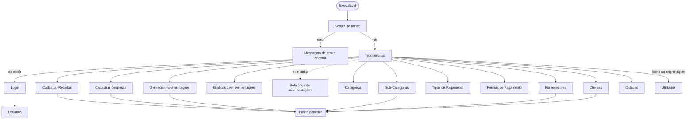
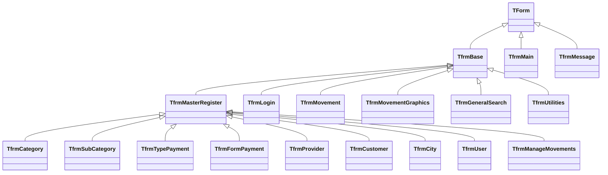

# Telas e rotinas: Personal Financial Control

Mapeamento das telas (formulários) e das rotinas (classes e métodos) da versão Delphi. Serve de referência para manutenção e para a migração para a versão nova em JavaScript (aplicação desktop com Electron e aplicação web, que compartilham regras e interface).

> Este documento **descreve o estado atual** do sistema, incluindo botões sem ação e telas incompletas. As regras de negócio estão em [BUSINESS_RULES.md](BUSINESS_RULES.md) e o banco em [DATABASE.md](DATABASE.md).

## Sumário

1. [Mapa de navegação](#1-mapa-de-navegação)
2. [Inicialização](#2-inicialização)
3. [Padrões de interface](#3-padrões-de-interface)
4. [Catálogo de telas](#4-catálogo-de-telas)
5. [Detalhe das telas](#5-detalhe-das-telas)
6. [Rotinas (camada não visual)](#6-rotinas-camada-não-visual)
7. [Pendências de interface](#7-pendências-de-interface)

---

## 1. Mapa de navegação

Todas as telas abrem como **modais** (`ShowModal`): enquanto uma está aberta, a de trás fica bloqueada.

A **Busca genérica** e a **Mensagem** são telas auxiliares chamadas por várias outras (ver [seção 3](#3-padrões-de-interface)).

---

## 2. Inicialização

Sequência em `PersonalFinancialControl.dpr`:

1. `Application.Initialize`, título "Personal Financial Control".
2. `TDataBaseScripts.ExecuteScripts`: conecta ao banco e cria a tabela `CITY` se não existir.
   - Se falhar: mostra "Atenção, ocorreu um erro ao tentarmos atualizar a estrutura do banco de dados…" e encerra.
3. Configura as cores do tema em `TSystemManager.LayoutConfiguration` (ver [3.5](#35-tema-visual)).
4. Cria a tela principal (`frmMain`) e os data modules `dtmMovements` e `dtmConnection`.
5. Ao exibir a tela principal (`FormShow`), abre o **Login**.
6. Login válido: carrega o usuário em `TSystemManager.LoggedUser` e mostra o nome dele na tela principal.

---

## 3. Padrões de interface

### 3.1 Hierarquia de formulários (herança visual)

| Template | Arquivo | O que oferece |
|---|---|---|
| `TfrmBase` | `templates/fBase` | Duas opções desligadas por padrão: fechar com **Esc** (`FormCloseWithEsc`) e **Enter funcionar como Tab** (`ChangeEnterToTab`; não vale para o campo de pesquisa) |
| `TfrmMasterRegister` | `templates/fMasterRegister` | Layout completo de cadastro (abaixo). Liga o fechamento com Esc e abre maximizado |

### 3.2 Layout de cadastro (`TfrmMasterRegister`)

Usado por 9 telas. Tem dois estados, alternados escondendo e mostrando abas:

| Estado | O que aparece | Como entra |
|---|---|---|
| **Consulta** (inicial) | Painel "Opções de pesquisa" (campo de busca + lupa + limpar), aba **Consulta** com a grade e barra de botões | Ao abrir, ao Salvar ou ao Cancelar |
| **Cadastro** | Aba **Cadastro** → **Básico** com os campos e os botões **Salvar** / **Cancelar**. A pesquisa e a barra de botões ficam ocultas | Incluir, Alterar ou duplo clique na grade |

**Barra de botões (estado Consulta):** Incluir · Alterar · Excluir · Imprimir · Fechar.
**Menu de contexto da grade** (botão direito): Incluir · Alterar · Excluir · Imprimir · — · Fechar.

Cada tela filha implementa os métodos abstratos do template:

| Método | Disparado por | Comportamento padrão nas telas filhas |
|---|---|---|
| `SearchExecute` | Abrir a tela, Enter no campo de pesquisa, lupa, após salvar/excluir | Busca pelo nome com `LIKE '%texto%'`, esconde as colunas `ID` e `UNIQUE_ID`, ajusta larguras |
| `InsertRegister` | Incluir | Muda para Cadastro, limpa os campos, foca o primeiro campo |
| `EditRegister` | Alterar, duplo clique | Muda para Cadastro e preenche os campos **com os valores da linha da grade** |
| `SaveRegister` | Salvar | Inclui ou altera (conforme `FOperationType`), volta para Consulta e refaz a busca |
| `CancelRegister` | Cancelar | Volta para Consulta sem gravar |
| `DeleteRegister` | Excluir | Pergunta "Deseja realmente excluir o registro?" (padrão: **Não**), exclui pelo `UNIQUE_ID` e refaz a busca |
| `PrintRegister` | Imprimir | **Vazio em todas as telas** |
| `CloseForm` | Fechar, Esc | Fecha a tela |

**Teclado no estado Consulta:** Enter no campo de pesquisa executa a busca; ↑ / ↓ no campo de pesquisa movem a seleção da grade; Esc fecha a tela.
**Teclado no estado Cadastro:** como o template liga `KeyPreview`, Esc também fecha a tela neste estado, descartando o que foi digitado. *Deduzido do código, não testado.*
**Grade vazia:** Alterar abre o Cadastro com os campos vazios, e Salvar faz um `UPDATE … WHERE UNIQUE_ID = ''`, que não altera nada nem avisa; Excluir pede confirmação e não exclui nada. *Deduzido do código (`FieldByName` em consulta vazia), não testado.*
**Grade:** somente leitura; a linha selecionada é pintada com a cor de título do tema.

### 3.3 Busca genérica (`TfrmGeneralSearch`)

Janela de seleção reaproveitada para escolher um registro relacionado. Quem chama define a entidade (`SearchEntityType`) e lê o objeto escolhido depois que a janela fecha.

| Entidade (`TSearchEntityType`) | Título | Colunas exibidas |
|---|---|---|
| `setCategory` | Pesquisar Categorias | Nome |
| `setSubCategory` | Pesquisar Sub-Categorias | Nome, Nome Categoria |
| `setCustomer` | Pesquisar Clientes | Colunas de pessoa (ver Fornecedores) |
| `setProvider` | Pesquisar Fornecedores | Colunas de pessoa |
| `setTypePayment` | Pesquisar Tipos de Pagamento | Nome, Permite Parcelamento |
| `setFormPayment` | Pesquisar Formas de pagamento | Nome, Nº Max. Parcelas, Tipo de Pagamento |
| `setCity` | Pesquisar Cidades | Nome, Cod. Cidade, UF |

- Ao abrir, já lista todos os registros.
- Enter no campo executa a busca; ↑ / ↓ navegam na grade.
- **Selecionar** ou duplo clique: carrega o registro completo (`GetById`) e fecha com `mrOk`.
- **Cancelar** fecha sem seleção. Esc **não** fecha esta janela.

### 3.4 Mensagens (`TfrmMessage`)

Substitui o `ShowMessage` padrão. Chamada por `TfrmMessage.ShowMessageBox(tipo, título, mensagem)`.

| Tipo | Título padrão | Ícone (`images/`) |
|---|---|---|
| `mtSuccess` | Sucesso | `outline_check_circle_white_48dp.png` |
| `mtWarning` | Atenção | `outline_warning_white_48dp.png` |
| `mtError` | Erro | `outline_error_white_48dp.png` |
| `mtInformation` | Informação | `outline_priority_high_white_48dp.png` |

- Abre maximizada, com fundo escuro e um painel centralizado; só tem o botão **OK**, e Enter também confirma.
- Se o título vier vazio, usa o título padrão do tipo.

As **perguntas de confirmação** (excluir, pagar, apagar tudo) **não** usam esta tela: usam o `Application.MessageBox` do Windows, com os botões Sim / Não e o **Não** selecionado por padrão.

### 3.5 Tema visual

Definido em `PersonalFinancialControl.dpr` e aplicado por cada tela no `SetColors`. Os valores Delphi estão em BGR; abaixo, convertidos para hexadecimal RGB.

| Propriedade | Delphi | Cor | Uso |
|---|---|---|---|
| `TitleColor` | `$007DA640` | `#40A67D` (verde) | Faixa de título, linha selecionada na grade, textos do login |
| `TitleFontColor` | `clWhite` | `#FFFFFF` | Texto do título |
| `ActionButtonColor` | `$00635A4B` | `#4B5A63` | Fundo dos botões |
| `ActionButtonFontColor` | `clWhite` | `#FFFFFF` | Texto dos botões |
| `HoverActionButtonColor` | `clWhite` | `#FFFFFF` | Fundo do botão com o mouse em cima ou com foco |
| `ActionButtonHoverFontColor` | `clBlack` | `#000000` | Texto do botão com o mouse em cima ou com foco |
| `BackgroundColor`, `SearchPanelColor`, `MainPanelColor`, `MainPanelRegisterColor`, `RegisterPanelColor`, `PanelBottomColor` | `$00242424` | `#242424` | Fundos |
| `PopUpBackgroundColor` | `$004A4B49` | `#494B4A` | Fundo do login e das mensagens |

**Fonte:** as telas usam **Calibri** (`Font.Name = 'Calibri'` nos `.dfm`). A exceção são os títulos de coluna das grades de `fMovementGraphics` (`Title.Font.Name = 'Tahoma'`). Na versão nova, a fonte é a variável `--font-family` de `packages/ui/src/styles/theme.css`.

Os "botões" são `TPanel` com efeito de hover feito manualmente (`OnMouseEnter`/`OnMouseLeave`/`OnEnter`/`OnExit` → `TFunctions.SetButtonColors`).

---

## 4. Catálogo de telas

| Tela | Arquivo | Classe | Herda de | Aberta por | Situação |
|---|---|---|---|---|---|
| Principal | `fMain` | `TfrmMain` | `TForm` | Inicialização | Ativa |
| Login | `forms/fLogin` | `TfrmLogin` | `TfrmBase` | Principal (ao exibir) | Ativa |
| Usuários | `forms/fUser` | `TfrmUser` | `TfrmMasterRegister` | Login → "Cadastrar Usuário" | Ativa |
| Categorias | `forms/fCategory` | `TfrmCategory` | `TfrmMasterRegister` | Menu | Ativa |
| Sub-Categorias | `forms/fSubCategory` | `TfrmSubCategory` | `TfrmMasterRegister` | Menu | Ativa |
| Tipos de Pagamento | `forms/fTypePayment` | `TfrmTypePayment` | `TfrmMasterRegister` | Menu | Ativa |
| Formas de Pagamento | `forms/fFormPayment` | `TfrmFormPayment` | `TfrmMasterRegister` | Menu | Ativa |
| Fornecedores | `forms/fProvider` | `TfrmProvider` | `TfrmMasterRegister` | Menu | Ativa |
| Clientes | `forms/fCustomer` | `TfrmCustomer` | `TfrmMasterRegister` | Menu | Ativa |
| Cidades | `forms/fCity` | `TfrmCity` | `TfrmMasterRegister` | Menu | Ativa |
| Cadastro de Receitas / Despesas | `forms/fMovement` | `TfrmMovement` | `TfrmBase` | Menu (2 botões) | Ativa |
| Gerenciar movimentações | `forms/fManageMovements` | `TfrmManageMovements` | `TfrmMasterRegister` | Menu | Ativa, com partes incompletas |
| Gráficos de movimentações | `forms/fMovementGraphics` | `TfrmMovementGraphics` | `TfrmBase` | Menu | Ativa |
| Utilitários | `forms/fUtilities` | `TfrmUtilities` | `TfrmBase` | Ícone de engrenagem | Ativa (aba "Temas" vazia) |
| Busca genérica | `forms/fGeneralSearch` | `TfrmGeneralSearch` | `TfrmBase` | Várias telas | Auxiliar |
| Mensagem | `forms/fMessage` | `TfrmMessage` | `TForm` | Várias telas e classes | Auxiliar |
| Relatório de movimentação | `reports/reportMovements.fr3` | (FastReport) | — | — | Layout pronto, **não ligado** |

---

## 5. Detalhe das telas

### 5.1 Tela principal (`fMain`)

Janela maximizada com faixa de título, nome do usuário logado ("Usuário") e o menu em botões.

| Botão do menu | Abre |
|---|---|
| Cadastrar Receitas | Cadastro de movimentos em modo **Receita** (título com a cor do botão) |
| Cadastrar Despesas | Cadastro de movimentos em modo **Despesa** (título com a cor do botão) |
| Gerenciar movimentações | Gerenciar movimentações |
| Relatórios de movimentações | **Nada** (sem evento) |
| Gráficos de movimentações | Gráficos |
| Categorias / Sub-Categorias | Cadastros correspondentes |
| Tipos de Pagamento / Formas de Pagamento | Cadastros correspondentes |
| Fornecedores / Clientes / Cidades | Cadastros correspondentes |
| Ícone de engrenagem (`imgButtonUtilities`) | Utilitários |

Rodapé: "Desenvolvido por Vagner Oliveira".

### 5.2 Login (`fLogin`)

Tela sem borda e sem botões de janela, maximizada, com um painel central.

| Elemento | Função |
|---|---|
| Usuário | Login |
| Senha | Senha (mascarada com `*`) |
| **Confirmar** | Valida em `TUser.ValidateLogin`. Se correto, carrega o usuário logado e fecha; se não, mostra "Atenção! Usuário e/ou senha inválidos…" |
| **Cancelar** | Encerra a aplicação (`Application.Terminate`) |
| **Cadastrar Usuário** | Abre a tela de Usuários, sem exigir login |

### 5.3 Telas de cadastro simples

Todas seguem o layout da [seção 3.2](#32-layout-de-cadastro-tfrmmasterregister). A coluna "Lookup" indica os campos preenchidos pela Busca genérica (lupa + botão de limpar).

| Tela | Campos no cadastro | Lookup | Colunas da grade |
|---|---|---|---|
| **Categorias** | Nome | — | Nome |
| **Sub-Categorias** | Nome, Categoria | Categoria | Nome, Nome Categoria |
| **Tipos de Pagamento** | Nome, Permite parcelamento (combo Não/Sim; padrão Não) | — | Nome, Permite Parcelamento |
| **Formas de Pagamento** | Nome, Tipo de pagamento (combo carregado do cadastro de tipos), Nº máximo de parcelas (só números) | — | Nome, Nº Max. Parcelas, Tipo de Pagamento |
| **Fornecedores** | Nome, Telefone, E-mail, Endereço, Número, Bairro, Cidade | Cidade | Nome, Fone, E-Mail, Endereço, Número, Bairro, Nome Cidade |
| **Clientes** | Iguais a Fornecedores | Cidade | Iguais a Fornecedores |
| **Cidades** | Nome, Código (só números), UF (combo com as 27 UFs; padrão RS) | — | Nome, Cod. Cidade, UF |
| **Usuários** | Nome, Login, Senha (mascarada) | — | Nome, Login |

Observações por tela:

- **Categorias:**
  - O rótulo do campo no Cadastro está em inglês ("Name"); a grade mostra "Nome". O mesmo acontece em Cidades, Tipos de Pagamento e Usuários. Na versão nova de Categorias, o texto "Name" foi mantido por decisão do usuário (12/10/2026).
  - Ao Incluir, `ClearFields` (`TFunctions.clearFormFields`) limpa **todos** os `TEdit` da tela, inclusive o campo de pesquisa; por isso, depois de Salvar, a busca refeita lista todos os registros. *Deduzido do código, não testado.* As outras telas de cadastro também chamam `ClearFields` (não verificado em que ponto).
- **Sub-Categorias:** ao alterar, carrega o registro do banco (`GetById`) para mostrar a categoria atual.
- **Formas de Pagamento:** ao alterar, recarrega o combo de tipos e seleciona o tipo atual pelo ID.
- **Fornecedores / Clientes:**
  - Mesma tela-base. A diferença é o filtro `TYPE_PERSON` fixo na busca (Fornecedor = 0, Cliente = 1).
  - Ao alterar, o campo Cidade mostra o **ID** da cidade, não o nome.
  - Ambas têm um método `GetTypePaymentList` vazio, sobra de cópia da tela de Formas de Pagamento.
- **Usuários:** a coluna Senha vem na consulta, mas fica oculta na grade; ao alterar, a senha atual é carregada no campo.

### 5.4 Cadastro de Receitas / Despesas (`fMovement`)

Janela com borda fixa, sem botões de janela. A mesma tela serve aos dois tipos; o tipo é definido pelo botão do menu (`TypeMovement`).

| Modo | Título | Rótulo da pessoa | Busca de pessoa |
|---|---|---|---|
| Receita | Cadastro de Receitas | Clientes | Clientes |
| Despesa | Cadastro de Despesas | Fornecedores | Fornecedores |

**Aba "Informações da conta"**

| Campo | Tipo | Observações |
|---|---|---|
| Descrição da conta | texto | — |
| Forma de pagamento | lookup | F12 ou lupa |
| Pessoa (Clientes/Fornecedores) | lookup | F12 ou lupa |
| Sub-Categoria | lookup | F12 ou lupa |
| Quantidade de parcelas | texto | Padrão `1`. Ao sair do campo: se > 1, mostra o botão **Gerar Parcelas** e a aba **Parcelas**, e os rótulos viram "Data do primeiro vencimento" / "Valor das parcelas"; se = 1, esconde ambos e os rótulos viram "Data de vencimento" / "Valor" |
| Valor das parcelas | texto | Aceita só dígitos, `,` e `.` (convertidos para o separador decimal) e um único separador. Ao sair, formata como `#,##0.00` |
| Data do primeiro vencimento | data | Padrão: hoje |

**Aba "Parcelas"** (visível se a quantidade for > 1)
- Grade com Parcela, Descrição, R$ Valor, Vencimento, alimentada por uma tabela em memória (`TFDMemTable`).
- A grade não é somente leitura: as linhas geradas podem ser editadas antes de salvar.

**Botões**

| Botão | Ação |
|---|---|
| Gerar Parcelas | Gera a lista de parcelas na aba Parcelas e muda para ela |
| Salvar | Grava cada parcela como um registro em `MOVEMENT` e mostra "Parcelas geradas com sucesso." |
| Cancelar | Fecha sem gravar |

**Teclado:** Enter avança para o próximo campo; F12 nos campos de lookup abre a Busca genérica.
Os botões de "limpar" ao lado dos lookups **não têm ação**.

### 5.5 Gerenciar movimentações (`fManageMovements`)

Usa o layout de cadastro, com extras.

**Filtros (painel de pesquisa)**

| Filtro | Opções | Padrão ao abrir |
|---|---|---|
| Pesquisar | texto na descrição (`LIKE`) | vazio |
| Situação | Todas · Não Pagas · Pagas | Todas |
| Mês | Todos · Janeiro … Dezembro | **mês atual** |

**Grade:** Descrição, Vencimento, R$ Valor, Número (parcela), Tipo (Entrada/Saída), Sub Categoria, Forma de Pagamento, Fornecedor, Situação (Pago/Não Pago). Ordenada por descrição, de Z a A.

**Totais** (painel abaixo da grade, recalculados a cada busca):
- Total de Receitas: R$ …
- Total de Despesas: R$ …
- Saldo: R$ …

**Ações**

| Ação | Onde | Comportamento |
|---|---|---|
| Incluir | botão / menu | Abre o formulário vazio, mas **o salvar não lê os campos** (ver [pendências](#7-pendências-de-interface)) |
| Alterar | botão / menu / duplo clique | Carrega o movimento do banco; edita Descrição, Fornecedor, Sub-Categoria, Forma de pagamento, R$ Valor e Data de vencimento |
| Excluir | botão / menu | Confirmação, depois exclui **somente a parcela selecionada** |
| Realizar Pagamento | menu de contexto | Pergunta "Deseja realmente efetuar o pagamento?" e marca a parcela como paga |
| Imprimir | botão | Executa a consulta do relatório, mas **não exibe nada** |
| Exportar PDF | botão | **Sem ação** |
| Fechar | botão / Esc | Fecha |

Nesta tela, o lookup de pessoa é sempre de **Fornecedores**, inclusive ao editar uma receita.

### 5.6 Gráficos de movimentações (`fMovementGraphics`)

Janela maximizada com três abas.

| Aba | Conteúdo |
|---|---|
| Visualizar em Gráficos | 6 gráficos de pizza (TeeChart), sem rótulos nas fatias e com cores aleatórias a cada atualização |
| Visualizar em listas | 6 grades (Nome, Total) com os mesmos dados |
| Visualizar os totais | Painel de **filtros** e botão **Atualizar pesquisa** |

**Os 6 agrupamentos** (soma de `INSTALLMENT_VALUE`)

| | Despesas (Saídas) | Receitas (Entradas) |
|---|---|---|
| por forma de pagamento | ✔ | ✔ |
| por categoria | ✔ | ✔ |
| por sub-categoria | ✔ | ✔ |

**Filtros**

| Filtro | Opções | Padrão ao abrir |
|---|---|---|
| Situação | Todas · Não Pagos · Pagos | Todas |
| Filtrar datas por | Mês · Ano · Período | Mês |
| Mês/Ano | Mês: Janeiro…Dezembro · Ano: 2020…2030 | mês atual |
| Data Inicial / Data Final | datas (só no modo Período) | hoje − 30 dias / hoje |

Ao abrir, a tela aplica os filtros padrão e já carrega os gráficos.
Na aba de listas, os rótulos "Saídas por categoria" e "Saídas por sub-categoria" estão **trocados** em relação às grades que ficam embaixo deles.

### 5.7 Utilitários (`fUtilities`)

| Aba | Conteúdo |
|---|---|
| Scripts | Botão **Apagar todos os dados**: confirmação, depois limpa o banco e recria os dados padrão (ver [BUSINESS_RULES.md](BUSINESS_RULES.md#rn-50-apagar-todos-os-dados)) |
| Temas | Vazia |

---

## 6. Rotinas (camada não visual)

### 6.1 Classes de entidade (`class/`)

Todas seguem o mesmo contrato (`ICrudInterface`, em `interfaces/uCrudInterface.pas`). Cada classe tem um `DataSet` próprio e um objeto de filtros (`SearchFiltersCustomized`, derivado de `TSearchFilters`).

| Classe | Tabela | Métodos além do CRUD | Objetos relacionados | Usada pelas telas |
|---|---|---|---|---|
| `TUser` | `USER` | `ValidateLogin(login, senha)` | — | Login, Usuários |
| `TCategory` | `CATEGORY` | — | — | Categorias, Busca, Scripts |
| `TSubCategory` | `SUB_CATEGORY` | — | `Category` | Sub-Categorias, Busca |
| `TTypePayment` | `TYPE_PAYMENT` | — | — | Tipos de Pagamento, Formas de Pagamento, Busca, Scripts |
| `TFormPayment` | `FORM_PAYMENT` | — | `TypePayment` (só o ID é carregado) | Formas de Pagamento, Busca |
| `TCity` | `CITY` | — | — | Cidades, Busca |
| `TPerson` | `PERSON` | — | `City` | base de `TProvider` / `TCustomer` |
| `TProvider` | `PERSON` (tipo 0) | — | — | Fornecedores, Busca, Movimentos |
| `TCustomer` | `PERSON` (tipo 1) | — | — | Clientes, Busca, Movimentos |
| `TMovement` | `MOVEMENT` | `MakePayment`, 6 consultas de agregação (`GetQuery…`) | `SubCategory`, `FormPayment`, `Provider`, `Customer` | Movimentos, Gerenciar, Gráficos |

**Métodos do CRUD**

| Método | O que faz | SQL |
|---|---|---|
| `Clear` | Zera as propriedades do objeto | — |
| `GetById` | Carrega o objeto a partir de `Id`; também carrega os objetos relacionados | `SELECT … WHERE ID = :ID` |
| `InsertRegister` | Gera um UUID novo e insere com o `ID_USER` do usuário logado | `INSERT` + `COMMIT` |
| `UpdateRegister` | Altera os campos editáveis | `UPDATE … WHERE UNIQUE_ID = :UNIQUE_ID` + `COMMIT` |
| `DeleteRegister` | Exclui | `DELETE … WHERE UNIQUE_ID = :UNIQUE_ID` + `COMMIT` |
| `Search(DataSet)` | Abre a consulta da grade no `DataSet` informado, com apelidos de coluna em português | `SELECT` com `LIKE` concatenado |

Em caso de exceção, os métodos fazem `ROLLBACK` e mostram uma mensagem de erro da `uAppConstants` (exceto `TPerson`, que não mostra nada). **A exceção não é repassada** para a tela.

**`TMovement`: rotinas específicas**

| Método | Finalidade |
|---|---|
| `Search` | Listagem do Gerenciar movimentações, com filtros de descrição, situação e mês. Também grava o SQL gerado em `TMovement.Search.txt`, na pasta do executável |
| `MakePayment` | `UPDATE MOVEMENT SET SITUATION = 1` |
| `GetQueryFormPaymentsExpenses` / `…Revenues` | Total por forma de pagamento |
| `GetQueryCategoryExpenses` / `…Revenues` | Total por categoria (via subcategoria) |
| `GetQuerySubCategoryExpenses` / `…Revenues` | Total por subcategoria |

### 6.2 Infraestrutura

| Unidade | Classe | Responsabilidade |
|---|---|---|
| `uDataBaseConnection` | `TDataBaseConnection` (singleton) | Conexão FireDAC/SQLite; `NewConnection` aponta para `database\PersonalFinancialControl` |
| | `TMyQuery`, `TMyScript` | `TFDQuery` / `TFDScript` já ligados à conexão única |
| `uDataBaseScripts` | `TDataBaseScripts` | Criação de `CITY`, limpeza geral e carga dos dados padrão |
| `uSystemManager` | `TSystemManager` (singleton) | Usuário logado (`LoggedUser`) e cores (`LayoutConfiguration`) |
| `uLayoutConfiguration` | `TLayoutConfiguration` | Propriedades de cor do tema |
| `uFunctions` | `TFunctions` | Caminhos (`ApplicationPath`, `DataBasePath`), `GenerateUUID`, `AppVersion` (= `1.1.1`), `clearFormFields`, `IntegerToBoolean`, formatação de campos decimais, centralizar painel, cores de botão |
| `uClassHelperTEdit` | helper de `TEdit` | `clearWithX`, `textToCurrency`: **não usados** |
| `uAppConstants` | — | Nome do banco, nome do desenvolvedor, mensagens de erro e caminhos dos ícones |
| `uEnumTypes` | — | Enumerações (operação, modo de tela, tipo de pessoa, entidade de busca, tipo de movimento, tipo de mensagem) |
| `dataModules/dConnection` | `TdtmConnection` | Conexão em tempo de design; não usada em tempo de execução |
| `dataModules/dMovements` | `TdtmMovements` | `qryMovementsReport`, consulta preparada para o relatório |

---

## 7. Pendências de interface

Itens visíveis na tela que não funcionam ou estão incompletos. Os detalhes de regra estão em [BUSINESS_RULES.md](BUSINESS_RULES.md#8-divergências-conhecidas).

| Tela | Item | Situação |
|---|---|---|
| Principal | Botão "Relatórios de movimentações" | Sem evento |
| Todos os cadastros | Botão / menu "Imprimir" | Método vazio |
| Gerenciar movimentações | Imprimir | Abre a consulta mas não exibe o relatório |
| Gerenciar movimentações | Exportar PDF | Sem evento |
| Gerenciar movimentações | Incluir → Salvar | Grava um movimento vazio |
| Cadastro de movimentos / Gerenciar | Botões de limpar ao lado dos lookups | Sem evento |
| Cadastro de movimentos | Título da janela | Mostra "Receitas" também no modo Despesa |
| Gráficos | Aba "Visualizar em listas" | Rótulos de categoria e sub-categoria trocados |
| Gráficos | Nome da aba "Visualizar os totais" | Contém os filtros, não totais |
| Utilitários | Aba "Temas" | Vazia |
| Fornecedores / Clientes | Campo Cidade ao alterar | Mostra o ID em vez do nome |
| Login | "Cadastrar Usuário" | Acessível sem estar logado |
